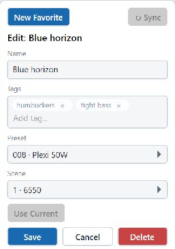
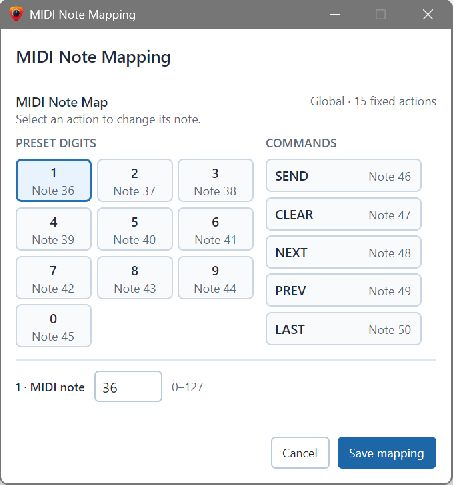

# Preset Maestro

User manual • Draft for feedback • 20 October 2026

For guitarists using Fractal Audio FM9, FM3 and Axe-Fx III

Preset Maestro gives you quicker access to your sounds and more ways to organise and explore them. Jump to a preset from a keyboard, number pad or MIDI controller. Keep favourite scenes ready to recall. Add your own tags to find sounds by their character, the guitar they suit or the effects they use. Look up amps by their real names and find where you use them.

You can keep different favourites and tags for each band or recording project, and work with several Fractal units, including more than one of the same model.

## Find the job you want to do

| I want to… | Go to |
| --- | --- |
| Connect my Fractal and get started | 1. Connect and prepare your sounds |
| Reach a distant preset without changing banks | 2. Go straight to a sound |
| Remember a scene I want to use again | 3. Make and recall a favourite |
| Arrange favourites for playing | 4. Keep your favourite numbers useful |
| Find sounds for a guitar, tone or effect | 5. Organise sounds with tags |
| Explore scenes across my collection | 6. Browse presets and scenes |
| Find the real amp behind a model name | 7. Explore amps and find where you use them |
| Use a pad or foot controller | 8. Play using a MIDI controller |
| Keep bands or clients separate | 9. Set up profiles for different projects |
| Use another unit or move to another computer | 10. Devices, copies and backups |
| Refresh the list after editing sounds | 11. Keep the app up to date with your Fractal |
| Get something working again | 12. When something does not work |

## About this edition

This draft follows version 1.2.29 and Windows screens. The examples use a saved FM9 collection and illustrative favourite names and tags. Screenshots show the app disconnected; loading sounds requires a connection.

**FM9 has the most complete support in this build.** FM3 and Axe-Fx III preset sending is available, but live preset/scene name reading and tracking the active scene are currently enabled for FM9 only. Full preset reading on FM3 and Axe-Fx III still needs hardware verification, and their amp catalogues are not populated. The browsing instructions apply where saved device data is available. FM3 also needs a standard MIDI connection for this app; see section 1.

Button names appear in **bold**. The app uses the spelling **Favorites**, which is retained when naming that page.

<!-- pagebreak -->
# 1. Connect and prepare your sounds

Keep your usual guitar and listening connections. Save any sound edits you want to keep before trying other presets.

## Choose your connection

**FM9 or Axe-Fx III over USB:** connect the unit to your computer with a USB data cable. On Windows, install the appropriate Fractal USB driver if needed. Use the official [FM9 downloads](https://www.fractalaudio.com/fm9-downloads/) or [Axe-Fx III downloads](https://www.fractalaudio.com/axe-fx-iii-downloads/) page and follow its installation instructions.

**Standard MIDI, including FM3:** connect a MIDI interface to your computer. Connect the interface's **MIDI Out** to the Fractal's **MIDI In**, and the Fractal's **MIDI Out** to the interface's **MIDI In**. Both directions are needed to send selections and read information back.

The FM3's USB connection works with Fractal's own applications but does not appear as an ordinary MIDI port. For Preset Maestro, use its standard MIDI sockets through an interface. See the [FM3 owner's manual, USB section](https://www.fractalaudio.com/downloads/manuals/FM3/FM3-Owners-Manual.pdf).

## Connect in Preset Maestro

1. Open **Config**. Under **MIDI Connection**, select the device's **MIDI In** and **MIDI Out** ports. With a separate interface, choose that interface's ports.
2. Leave **Thru In(s)** unselected for now. These additional inputs are for controllers, covered in section 8.
3. Click **Connect**. Check that the **Sync with connected device** window identifies the expected device.
4. Keep the **Default** profile while getting started. When prompted, choose **Sync device** and allow the read to finish. A first complete read can take several minutes, particularly over standard MIDI.
5. When setup completes, open **Presets and scenes** and check that the expected names appear.

If an existing Default device is already in use, **Add new device & sync** keeps it separate. Choose a name that identifies the unit, such as *Gigging FM9*. Use **Overwrite Default & sync** only when you intend to replace that saved device information.

## If setup stops

Check the connection and choose **Resume sync** when offered. During first-time setup, disconnecting or closing an unfinished setup does not complete it. After a complete scan has been saved, later connections can offer **Skip for now** or **Use saved data**; you do not need to reread everything every time.

## Make the selections agree

In **Config → Device for this profile → Manage devices**, select your device and check **Preset Mapping**. The **MIDI channel** must agree with your Fractal. **Display offset** controls whether preset numbering begins at 000 or 001. **Scene CC#** must agree with the Fractal's Scene Select assignment; the app starts with 34. Choose **Save changes** after editing these settings. Section 12 explains what to check if the wrong sound loads.

<!-- pagebreak -->
# 2. Go straight to a sound

Use direct number entry when you already know which preset you want. You can move from preset 7 to preset 287 without stepping through the intervening banks.

## Use your keyboard or number pad

1. Open **Preset Sender** and keep Preset Maestro in the foreground.
2. Type the preset number using the number keys or a number pad.
3. Press **Enter** or click **SEND**.
4. Check the Fractal's display and play to confirm the selection.

**SENT** means that the app sent the command. Check the Fractal itself if you need to confirm it received the selection. Choosing a preset alone does not promise a particular scene; use a favourite when you want a specific preset and scene together.

| To… | Use… |
| --- | --- |
| Correct the last digit | **Backspace** |
| Clear the entered number | **CLR** or **Delete** |
| Send the entered number | **Enter** or **SEND** |
| Step backwards or forwards on Preset Sender | **PREV / NEXT**, or the left/right arrow keys |
| Return to the preceding preset on Preset Sender | **LAST** |

## Send without pressing Enter

In **Config → Entry Options**, enable **Auto-send full numbers**. On a 512-slot device, enter **007** for preset 7. Once three digits have been entered, the app sends the number after the chosen **Delay**. Start with this option off while learning the controls, then try it if it makes playing easier.

On a 1,024-slot device, **Preset Sender** and **Presets and scenes** accept four digits and auto-send waits for all four: use **0007** for preset 7. You can enter preset numbers above 999 directly on either page. **Favorites** always uses three digits for its slot numbers. With auto-send off, shorter numbers can be sent with **Enter**.

## Know what the number will select

| Page | The number you enter means… |
| --- | --- |
| **Preset Sender** | A preset number |
| **Favorites** | A favourite slot, which recalls its preset and scene |
| **Presets and scenes** | A preset number, even when you are browsing scenes |

On **Presets and scenes**, click the **Preset** number display before typing, then press **Enter**. You can enter a number even if that preset is outside the current search results. With no number entered, **SEND** loads the selected preset or scene.

If your typing appears in a search or name box, click the number display or leave the text box first. If no digits appear, check **Config → Entry Options → Keyboard entry** and, on a number pad, check Num Lock.

<!-- pagebreak -->
# 3. Make and recall a favourite

A favourite gives you one number for a sound you want to return to. Its preset and scene can be anywhere on the device.

## Save a sound you are playing

1. Open **Favorites** and click **New**.
2. On a connected FM9, click **Use Current** to fill in the preset and scene you are playing. Check the numbers. You can also choose them manually as described below.
3. Enter a name that will help you recognise the favourite.
4. Add any useful tags: type each one in **Tags** and press **Enter**. Section 5 gives examples.
5. Click **Save**. The favourite appears in the list with a **Slot** number.

**Save** stores the favourite in the active profile. It does not save sound edits on the Fractal. Use the Fractal or its editor to save those edits.

## Choose or try another sound

Click the **Preset** field to open its picker. Search by name or number, select a preset and choose **Select Preset**. Open the **Scene** field, choose a scene and select **Select Scene**. Finish with **Save** in the favourite editor.

To listen before deciding, use **Go to preset**, **Go to scene**, or double-click a picker result. The picker stays open while you try it. The **Select** buttons put your choice into the favourite you are editing; **Save** keeps it. **Cancel** discards the favourite edits, but does not undo a sound you already loaded to try.

## Recall it

Double-click the favourite's row. Or, on **Favorites**, enter its slot number and press **Enter** or **SEND**. Favourite 7 could recall preset 287, scene 3. A single click selects a row for inspection; it does not load the sound. The right-click menu also offers **Go to preset & scene**.

<!-- pagebreak -->
# 4. Keep your favourite numbers useful

Favourites are especially useful when you want a small, predictable set of sounds ready for practice, a rehearsal or a session. Their slot numbers stay meaningful even when you search or change how the list is displayed.

## Change an existing favourite

Right-click its row and choose **Edit**. Change the name, tags, preset or scene, then choose **Save**. Use **Cancel** if you want to leave the saved favourite as it was.

You can keep two differently named favourites pointing to the same scene. Where that scene is in the saved device collection, both favourites share its tags within the profile.

## Find a favourite quickly

Type into **Add tag or search term…**. You can search favourite names, tags, numbers and saved preset/scene names. Choose a suggested tag to filter by that tag, or the **Search text** suggestion to look for the words as ordinary text. Press Enter to keep a search term in place and add another.

Use **Clear search** to return to the full list. Searching does not load a sound, remove a favourite or change its slot number.

The details button beside the number display shows saved preset and scene names for all favourites. If a name or group of tags is shortened, hold the pointer over it to see the full text.

## Sort for browsing; reorder for playing

Click a column heading to sort by that column. Repeated clicks cycle through ascending, descending and the usual slot order. Sorting changes the display order, not the numbers you use to recall favourites.

To change the actual slot order, clear the search and return the headings to their usual unsorted order. Drag a favourite to its new position. Reordering changes slot numbers, so check the numbers you intend to enter from your controller afterwards.

The list may spread across several tables as you make the window wider. Follow the **Slot** numbers; the layout does not renumber favourites.

## Remove a favourite without upsetting the others

Right-click the favourite and choose the option that suits your purpose:

| Option | What happens |
| --- | --- |
| **Clear Slot** | Empties that slot and keeps the later slot numbers unchanged. Use this when you want your familiar numbers to stay put. |
| **Remove Slot and Shift Up…** | Removes the slot and moves later favourites up. Their slot numbers change. |

The editor's **Delete** button also offers these choices. Clearing or removing a favourite does not delete the preset on your Fractal. Shared scene tags stay with the scene when its shortcut is removed.

For another band's arrangement, copy the profile first, then reorganise the copy. That keeps your original band's numbers intact. See section 9.

<!-- pagebreak -->
# 5. Organise sounds with tags

Tags let you find sounds by qualities you care about, even when the preset names do not describe those qualities. You choose the tags after playing and deciding what suits your guitar and needs; the app does not judge the sound for you.

| Kind of tag | Examples |
| --- | --- |
| Guitar or pickup | *single coils*, *humbuckers* |
| Tone and feel | *warm*, *tight bass* |
| Effects | *slapback echo*, *wide stereo* |

## Build a useful collection gradually

When a sound works well with your humbucker guitar, add *humbuckers*. If its low end stays firm while you play, add *tight bass*. One scene can carry both labels. Start with a few terms you will remember and reuse the same wording for similar sounds.

In a favourite's editor, type each tag in **Tags** and press **Enter**, then choose **Save**. Remove a tag using its small remove button, then save. For a scene that is not a favourite, open its preset's details in **Presets and scenes**, select the scene and use **Add tag / Edit tags** followed by **Save tags**.

## Find a sound for the guitar in your hands

1. In **Favorites** or **Presets and scenes**, click **Add tag or search term…**.
2. Type *humbuckers* and choose the matching tag suggestion.
3. Add *tight bass* in the same way.
4. Choose **All tags** to show matches that meet both requirements.
5. Try a result by double-clicking it, or using its **Go to** action.

**Any tag** broadens the search. For example, choose *slapback echo* and *wide stereo* with **Any tag** when either effect would be interesting. With **All tags**, you are asking for both.

Spaces can be part of a tag: *tight bass* is one label. You do not need to join the words or add a # symbol. Capitalisation does not make a separate tag.

You can combine tags with name searches. Ordinary text terms all have to match, even with **Any tag** selected. Choose **Search text** if you want to search words that are also the name of an existing tag. Remove an individual search label with its small remove button, or choose **Clear search** to start again.

## Choose the right level

Tag a **scene** for a quality that applies to that sound. Tag a **preset** for a description that applies to the whole preset. Preset tags do not automatically become scene tags.

The **Presets** view can find tags on the preset or its scenes. **All tags** there can match tags spread across different scenes in one preset. Use the **Scenes** view when you need one scene that has all the selected qualities.

Scene tags are shared with all favourites pointing to that scene in the same profile. Editing them in either place updates the other. Different profiles keep their own tags, so the same sound can be organised differently for another band or client.

<!-- pagebreak -->
# 6. Browse presets and scenes

Use **Presets and scenes** when you want to explore sounds, remember what is inside a preset or find a scene without knowing its number.

## Explore one preset

1. Open **Presets and scenes** and choose **Presets**.
2. Search for a preset by name or use tags to narrow the list.
3. Single-click a preset to open the details beneath the list.
4. Choose **Scenes (8)** to see its scenes. Select the scene you want and use **Go to**, double-click it, or use **SEND** with no number entered.

A scene selection loads its preset first if needed. When the preset is already active, the scene action changes just the scene. Close the details with **× Close**, or press **Escape** while working inside the pane. Your search remains in place.

## Find scenes across different presets

Choose the **Scenes** view to see scenes from across the saved collection. Search text looks in scene names; tag filters look at the scene's own tags. To find a parent preset by its name, use **Presets** instead.

For example, select *single coils* and *warm* with **All tags** to find individual scenes you have labelled with both. You can try results from several presets without opening each preset in turn. Double-click a result or use **SEND** with no number entered. Use **Details** to inspect its preset and scene information.

## Understand the amp information

In a preset's **Scenes (8)** details, **Amp / Channel** shows the amp model and the channel used by each scene. If there are two Amp blocks, both can appear. **off** indicates a bypassed block.

Choose **Amp models** to inspect the models stored in the Amp block's channels A-D. This is helpful when comparing scenes that use different channels, or when an amp search found a preset and you want to see which scene uses the model.

These details describe the saved preset read during the last sync. Save changes on the Fractal and refresh the app if you have edited the sound since then.

## Selected does not always mean playing

The selection highlight shows the row you are inspecting. A red leading marker shows the preset or scene reported active by the connected device, where tracking is supported. Browsing, searching and editing tags do not themselves change the sound. Double-click, **SEND** and **Go to** are the actions that load sounds.

You can browse the saved list and organise tags while disconnected. Connect when you want to hear a result. If **Go to** is unavailable, finish any read or first-time setup and check that the profile is assigned to the connected device model.

<!-- pagebreak -->
# 7. Explore amps and find where you use them

Use **Amps** when you recognise a real amp name but cannot remember Fractal's model name, or when you want to find sounds that use a particular amp.

## Look up an amp

1. Open **Amps**.
2. Search for a manufacturer, real amp name or Fractal model name. You can also choose a manufacturer from the list.
3. Select an amp family to see its model variations and the names used on your Fractal.
4. Tick the variations you want to include under **Use in search**.
5. Click **Show presets for…**. The app lists saved presets containing any of the checked models.
6. Open a matching preset. Inspect **Scenes (8)** or **Amp models**, then choose a suitable scene to play.

**Back to Amps** returns you to your earlier amp search and choices. The **Wiki** links provide further reading when you want more detail about a model.

## Find something you have not tried

Choose **Not used in my presets** to look for amp families absent from your saved presets. Choose **Used in my presets** to revisit amps already in the collection, or **All amps** to browse the available catalogue.

An unused amp can give you an idea for a new sound. Note its exact Fractal model name and choose it in an Amp block on your Fractal or in its editor. This browser does not insert an amp into a preset.

## What counts as used?

The app checks every saved Amp channel, including channels that no scene currently selects. A preset can therefore appear in the results even when its currently playing scene uses another model. Check the scene's **Amp / Channel** or the **Amp models** table before deciding which sound to try.

The unused list applies to whole amp families: a family is unused only when none of its variations appears in the saved presets. It does not list every unused variation of an otherwise used family.

A complete scan and a matching catalogue are needed to identify unused amps. If the option is unavailable, complete or refresh the device sync. Some device/firmware combinations do not yet have a catalogue; the message on **Amps** explains that limit. After a Fractal firmware update, refresh all presets before relying on the list.

<!-- pagebreak -->
# 8. Play using a MIDI controller

A pad or foot controller, such as an SMC Pad Pocket or Behringer FCB1010, can work like a number pad. Configure it to send MIDI notes for digits and **SEND**. Its existing preset-change assignments may need changing.

## Connect the controller

1. Connect the controller to the computer by USB MIDI, or connect its MIDI output to an interface input.
2. In **Config → MIDI Connection**, keep the Fractal's own **MIDI In** and **MIDI Out** selected. Select the additional controller input under **Thru In(s)**.
3. Under **Entry Options**, enable **MIDI note entry**.
4. Open **MIDI note mapping → Configure…**.
5. Select an action, such as **1**, and enter the MIDI note number its pad or switch sends. Repeat for the other digits and commands, then choose **Save mapping**.

Use the controller's own instructions to set its outgoing notes. Match note **numbers**, since controller editors can use different octave names. Each note must identify one action. The screenshot shows the app's default assignments.

## Try it before playing

With auto-send off, open **Preset Sender** and press one digit. It should appear on screen without changing the preset yet. Enter a known number and press the controller's **SEND** switch. Check the Fractal, then try a favourite slot on **Favorites**. The active page determines what an entered number means. **NEXT**, **PREV** and **LAST** are preset actions; they do not step through favourite slots.

Select only one input route for each controller. If it is connected through both USB and an interface, selecting both can send every press twice. Other controller messages can pass through to the Fractal; their channel and assignments must agree with the device. The per-input **Omni** option accepts notes on any channel; a numbered setting accepts only that channel.

Note mappings and entry options are shared across profiles on this computer. Exporting a profile does not carry these controller settings to another computer.

<!-- pagebreak -->
# 9. Set up profiles for different projects

A profile keeps its own favourites and tags, and chooses which saved device it uses. Use profiles when the same collection needs to serve different purposes.

For example, keep one profile for each band so each has a familiar set of favourite numbers. For studio work, keep a profile for each artist or client, with the sounds and descriptions useful to that session. Several profiles can use the same Fractal while keeping their organisation separate.

## Start a new project

1. Open **Config → Profiles → Manage Profiles**.
2. Choose **Create…**, enter a useful name and choose **Create**.
3. Read any profile/device warning before continuing. The new profile becomes active and starts with empty favourites and saved names.
4. Return to **Config**. Under **Device for this profile**, select the existing saved device you want to use, or add another device as described in section 10.
5. Add favourites and tags for this project.

## Start from a collection you already like

In **Manage Profiles**, select the profile you want to start from and choose **Copy…**. Give the copy a new name. Copying brings across the favourites, tags, device assignment and saved names, and activates the copy.

You can now change the copy's favourite names, order and tags to suit the new band or session. Those changes do not change the original profile's favourites or tags. If both profiles use the same device, they still share that device's saved preset information and MIDI mapping settings.

## Switch before a rehearsal or session

Choose the required **Active profile** in **Config**, or select it in **Manage Profiles** and click **Use profile**. Merely selecting a row in the management list lets you inspect it; it does not activate it. The **Active** marker and the profile name at the top of the app show which one is in use.

The app checks the new profile against the connected unit where it can. If a warning reports different or unavailable names, check the device and profile before continuing. Choose **Cancel** to stay with the current profile. When disconnected, the app cannot check the unit; you can still deliberately switch for offline organisation.

Finish saving or cancelling favourite edits before switching. Search filters reset when you switch, so a previous band's search does not hide the new profile's favourites. Finish or stop a device read before changing profiles.

## Rename or remove a profile

Select the intended profile in **Manage Profiles**, then use **Rename…** or **Delete…**. These actions apply to the selected row, which may differ from the active profile. Export a profile you may need again before deleting it. At least one profile must remain. Deleting a profile does not erase sounds from your Fractal.

<!-- pagebreak -->
# 10. Devices, copies and backups

Use separate saved devices for separate Fractal units, even when they are the same model. A name such as *Gigging FM9* or *Studio FM9* is easier to recognise than two entries called Default.

## Add another unit

1. Open **Config → Device for this profile → Manage devices**.
2. Choose **+ Add device…**, enter a distinctive name and choose the device model if asked. When connected, the app uses the detected model.
3. Choose **Add device**, then **Use for this profile**.
4. In **Config**, select the MIDI ports for that physical unit and connect. Complete its device sync.

Each profile has one assigned device. Several profiles can share one device. Assigning a device chooses the saved information to browse; it does not change the cables, select a different MIDI port or copy sounds between units. When using another physical unit, check both the profile's assignment and the MIDI ports.

For Axe-Fx III, the first scan checks preset capacity. If the app cannot establish it, it may ask you to choose 512 or 1,024 slots. Choose the capacity of your actual unit.

## Make a copy you can keep or move

In **Config → Profiles → Manage Profiles**, select the profile and choose **Export…**. Save the ZIP file somewhere you will recognise. Repeat for other profiles you want to keep.

The export includes favourites, tags, saved names and available saved device information for browsing. It is a backup of your Preset Maestro organisation, **not a restorable backup of the Fractal's sound presets**. Use Fractal's own tools for device preset backups. MIDI port choices, controller note assignments and appearance settings belong to the computer and are not included.

## Use an exported profile on another computer

1. Open **Manage Profiles**, choose **Import…** and select the exported ZIP.
2. Choose a profile name. If that name already exists, use a different name to keep both, or deliberately choose **Overwrite** to replace the existing profile.
3. If offered a device choice, use an existing saved device when it is the same unit. Choose **Keep a separate imported device** when you want a separate saved copy.
4. Complete the import, then click **Use profile** when ready. Importing selects the new entry for inspection; it does not activate it automatically.
5. Set the new computer's MIDI ports and controller mapping. Connect the physical device and complete any requested check or sync before playing.

Sharing a device during import keeps its existing saved data. An imported collection can be browsed offline, but accepting a connection may require a fresh sync. **Scan profile files** finds profile files already on this computer; it does not read the Fractal.

To remove an unused device entry, first assign all its profiles elsewhere, then use **Delete…** in **Manage devices**. This removes its saved information and associated tags in Preset Maestro, not presets on the hardware. Export anything you want to retain first.

<!-- pagebreak -->
# 11. Keep the app up to date with your Fractal

Save sound edits on your Fractal before refreshing saved browsing and amp information. A refresh does not save the sound for you.

On FM9, the app can refresh saved names and follow confirmed scene swaps after an observed save. Unsaved or discarded edits leave saved names and tags unchanged. Use the actions below for changes made while disconnected, elsewhere in the list, or between automatic checks.

## Choose the refresh that fits the change

| What changed? | What to use |
| --- | --- |
| Several presets, amp settings, preset locations, or firmware | **Presets and scenes → Resync Presets** |
| Scenes or amp settings within one preset | Select it, then **Resync Scenes** in its details |
| Only preset names needed in the favourites picker | **Config → MIDI Connection → Sync options… → Sync names** |
| Only scene names for presets used by favourites | **Sync options… → Sync scenes** |
| First setup, an imported device, or a read to resume | **Sync options… → Sync device / Resync device / Resume sync**, as offered |

FM9 name-only reads leave scene and amp details unchanged. If unsure, refresh the full device.

## Check a returning device

Use **Start quick check** for names and sampled sounds, or **Start full check** for every preset and scene. FM9 checks refresh preset names; sync also updates scenes and amps.

If **Confirm device data update** appears, choose **View differences**. **Update device data** accepts the reads; **Cancel** keeps the saved copy. Check the connected unit and profile when differences are unexpected.

## Stop or continue a read

Use **Stop sync** or **Cancel read** for the operation shown. Config can retain completed reads for **Resume sync**. **Hide progress** keeps the read running.

Cancelled or unsuccessful **Resync Presets / Resync Scenes** keep prior information and tags; retries start fresh. After firmware changes, use **Resync Presets** first.

## Keep tags attached to the intended sounds

Ordinary renames and sound edits retain tags. If you move a preset to another slot, check its favourites and tags afterwards; they are not automatically carried to the new preset number.

When resync can confidently recognise reordered scenes, it can move their tags. Otherwise **Should tags follow these scenes?** shows the proposed changes. Choose **Follow scenes** if the tags should move with those sounds, or **Keep at positions** if they should remain at the scene numbers. **Cancel** leaves the refresh unapplied. Check favourite scene numbers separately; moving tags does not automatically change those shortcuts.

If **Needs review** appears, choose the intended preset and scene destinations, then **Attach tags to selected preset**. **Undo last tag reassignment** can reverse the most recent review decision when later edits have not made that unsafe.

<!-- pagebreak -->
# 12. When something does not work

## The device is missing from the port lists

Check that the unit and interface are switched on and connected, then choose **Refresh Devices** in Config. For USB, use a data cable and the correct driver for the device. For FM3, select a standard MIDI interface: its USB connection will not appear as an ordinary MIDI device. If another editor is using the ports, close it and try again.

## Connect fails, or reading never completes

Choose both input and output for the intended unit. With standard MIDI, check both cables: interface Out to Fractal In, and Fractal Out to interface In. A working outward connection alone can send commands but cannot return names or device information. Stop the read, correct the connection, reconnect and use **Resume sync** if offered.

## Presets do not change, or the wrong number loads

Check the active profile and assigned device. Under **Manage devices → Preset Mapping**, match **MIDI channel** to the unit and check **Display offset** against its numbering. The Fractal must accept Program Change messages. With offset 0, its Program Change mapping should be disabled. Choose **Save changes**, then try a known preset. If you are on **Favorites**, the number you type is a favourite slot, not a preset number.

## The preset changes but the scene is wrong

Edit the favourite and check its scene number. Check that **Scene CC#** in the saved device's mapping agrees with **Scene Select** on the Fractal; the app starts with 34. The MIDI channel must also match. Use your model's MIDI/Remote instructions when checking the hardware setting.

## Typing numbers does nothing, or starts a search

Bring Preset Maestro to the foreground. Enable **Keyboard entry** in Config. Click the number display or leave any search/name field before entering a command. Check Num Lock on a number pad. For a MIDI controller, enable **MIDI note entry**, select its input, check its note numbers and check the input channel filter.

## A controller press happens twice, or an effect switches back

Use only one input route for that controller. If both its USB connection and its interface input are selected, the same press may arrive twice. Check the controller's own setup if it also sends extra commands from one switch.

## Names or amp details look old, or results are missing

Save edits on the Fractal, then use the appropriate refresh in section 11. Clear the search and check **All tags / Any tag**, the selected profile and the assigned device. In **Scenes**, text searches scene names; use **Presets** for a preset-name search. If unused amps cannot be listed, the scan may be incomplete or the device's amp catalogue may not yet be available.

## A button is greyed out

Hold the pointer over it for the explanation. Common reasons are no connection, a different device model, an unfinished first sync or another read in progress. FM3 and Axe-Fx III do not yet have the same name-reading and amp-catalogue support as FM9. If you need to report a problem, note the app version shown in Config, device model, what you were trying to do and the exact message. **Diagnostics** in Config can help investigate further.
